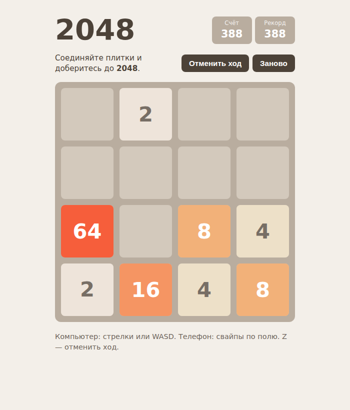

# 2048

Классическая игра 2048 с плавными анимациями, отменой ходов и сохранением партии между визитами.



## Возможности
- Поле 4×4, новая плитка: 2 с вероятностью 90%, иначе 4
- Управление стрелками, WASD (в том числе в русской раскладке) и свайпами на телефоне
- Плавное перемещение плиток через CSS transform, анимации появления и слияния
- Отмена до 20 последних ходов кнопкой или клавишей Z
- Счёт и рекорд, рекорд сохраняется в браузере
- Текущая партия сохраняется после каждого хода и восстанавливается при следующем открытии
- Экран победы при сборе 2048 с возможностью играть дальше
- Экран поражения, когда ходов больше нет
- Анимации отключаются при `prefers-reduced-motion`

## Стек
HTML, CSS, JavaScript без библиотек, `localStorage`, шрифт Rubik (Google Fonts).

## Как запустить
Сборка не нужна: откройте `index.html` в браузере.

Или через локальный сервер:
```bash
python -m http.server 8000
# затем откройте http://localhost:8000
```

## Управление
| Ввод | Действие |
|---|---|
| Стрелки или WASD (ФЦВЫ) | Сдвинуть плитки |
| Свайп по полю | Сдвинуть плитки |
| Z (Я) или кнопка «Отменить ход» | Отменить последний ход |
| Кнопка «Заново» | Новая игра |

## Структура проекта
```
index.html   # всё в одном файле: разметка, стили, логика игры
screenshot.png
LICENSE
```

## Как это устроено
- Любой ход сводится к сдвигу влево: функция `slide()` обрабатывает одну линию, а `move()` читает и записывает строки или столбцы в нужном порядке для каждого направления.
- Каждая плитка за ход сливается не больше одного раза.
- У каждой плитки есть постоянный `id`, поэтому DOM-элементы не пересоздаются, а только меняют `transform`; так получается плавная анимация движения.
- Ход не засчитывается, если поле не изменилось; это проверяется сравнением снимка значений до и после.
- История ходов хранит снимки поля и счёта, длина ограничена 20 записями.
- Чтение и запись `localStorage` обёрнуты в `try/catch`, игра работает и без доступного хранилища.

## Идеи для развития
- Выбор размера поля (3×3, 5×5)
- Анимация прибавки очков
- Статистика партий

## Лицензия
MIT © 2026 whysafe. Telegram: [@yawhysafe](https://t.me/yawhysafe) · Сайт: [whysafe.ru](https://whysafe.ru)
